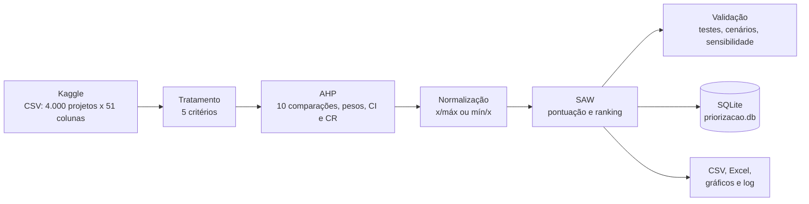
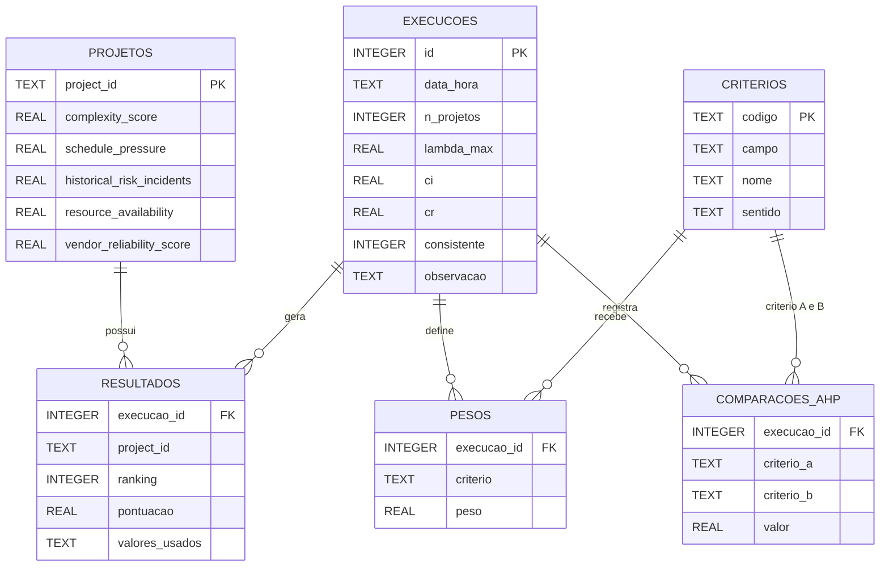

<div align="center">

# Sistema de Apoio à Decisão para Priorização de Projetos

### baseado nos métodos AHP e SAW


**Trabalho de Conclusão de Curso · Engenharia da Computação · Universidade Veiga de Almeida**

Victor Guilherme Moreira Pinto · Orientador: Prof. Vitor Amadeu

[Visão geral](#visão-geral) · [Resultados](#resultados) · [Critérios e pesos](#critérios-e-pesos) · [Banco de dados](#banco-de-dados) · [Como executar](#como-executar) · [Validação](#validação) · [Limitações](#limitações)

</div>

---

> [!WARNING]
> Os dados utilizados são **simulados**. Os resultados demonstram o funcionamento do método e **não representam projetos reais**.

## Visão geral

O sistema **ordena projetos por necessidade de atenção ao risco**:

- os **pesos** dos critérios vêm do método **AHP** (*Analytic Hierarchy Process*), com verificação de consistência;
- a **pontuação** de cada projeto vem da **soma ponderada** (**SAW**, *Simple Additive Weighting*);
- cada **execução** fica registrada em um banco **SQLite**, o que permite rastrear quais julgamentos geraram quais pesos e qual *ranking*.



Uma pontuação maior indica **maior necessidade de atenção ao risco**. Ela não indica um projeto melhor nem mais rentável.

## Resultados

| Item | Valor |
|---|---|
| Projetos processados | **4.000** |
| λmax | 5,0331 |
| CI (Índice de Consistência) | 0,0083 |
| CR (Razão de Consistência) | **0,0074** · consistente (limite de 0,10) |

| Posição | Projeto | Pontuação |
|:---:|---|:---:|
| 1º | PROJ_3003 | 0,6687 |
| 2º | PROJ_2001 | 0,6322 |
| 3º | PROJ_1837 | 0,6296 |

### Peso nominal × influência efetiva

<p align="center">
  
</p>

O critério C1 tem peso de 37,6% e responde por cerca de 47,7% da variação da pontuação. O C5 tem peso de 7,4% e influência de cerca de 2%. **O peso do AHP não corresponde, necessariamente, à influência efetiva no resultado**: ela também depende da dispersão dos dados e da normalização.

<details>
<summary><b>Mais gráficos</b></summary>

<p align="center">
  
</p>

<p align="center">
  
</p>

</details>

## Critérios e pesos

| Código | Campo | Interpretação adotada | Sentido | Normalização | Peso AHP |
|:---:|---|---|---|:---:|:---:|
| C1 | `Complexity_Score` | Complexidade do projeto | Maior = mais risco | x/máx | **37,60%** |
| C2 | `Schedule_Pressure` | Pressão sobre o cronograma | Maior = mais risco | x/máx | **21,47%** |
| C3 | `Historical_Risk_Incidents` | Incidentes históricos de risco | Maior = mais risco | x/máx | **21,47%** |
| C4 | `Resource_Availability` | Disponibilidade de recursos | Menor = mais risco | mín/x | **12,09%** |
| C5 | `Vendor_Reliability_Score` | Confiabilidade dos fornecedores | Menor = mais risco | mín/x | **7,38%** |

> [!NOTE]
> A documentação da base não detalha o significado e a escala desses campos. A interpretação acima é uma **hipótese do autor**.

### Fórmulas

**Pesos (AHP):** autovetor principal da matriz de comparação *A*, com os pesos somando 1.

```text
A · w = λmax · w          soma(w_i) = 1
CI = (λmax − n) / (n − 1)  CR = CI / RI      (RI = 1,12 para n = 5)
```

**Normalização:**

```text
maior = mais risco:   r_ij = x_ij / máx_j(x_ij)
menor = mais risco:   r_ij = mín_j(x_ij) / x_ij
```

**Pontuação (SAW):**

```text
S_j = soma_i ( w_i · r_ij )
```

Os projetos são ordenados da maior para a menor pontuação e, em caso de empate, pelo identificador.

### Julgamentos do AHP

Os julgamentos foram feitos pelo autor, em caráter experimental e sem consulta a especialistas. Cada um está justificado em [`documentacao/julgamentos_ahp.json`](documentacao/julgamentos_ahp.json). Para testar outros pesos, edite esse arquivo e execute o programa novamente. Se o CR passar de 0,10, a execução é interrompida.

## Banco de dados

O arquivo `resultados/priorizacao.db` é um banco relacional **SQLite** com seis tabelas.



| Tabela | O que armazena |
|---|---|
| `projetos` | Identificador de cada projeto e os valores dos cinco campos utilizados |
| `criterios` | Código, campo, nome e sentido de preferência de cada critério |
| `execucoes` | Cada execução, com data e hora, número de projetos, λmax, CI, CR, situação de consistência e versão dos pesos |
| `comparacoes_ahp` | Comparações par a par usadas em cada execução |
| `pesos` | Peso de cada critério em cada execução |
| `resultados` | Posição, pontuação e valores usados por cada projeto em cada execução |

As tabelas `comparacoes_ahp`, `pesos` e `resultados` usam o campo `execucao_id` para identificar a execução a que pertencem. Isso preserva a rastreabilidade: **dados → comparações → pesos → execução → resultado**.

O banco guarda a execução principal. Os resultados da sensibilidade e dos cenários de pesos ficam no Excel e no *log*. O repositório inclui uma cópia do `priorizacao.db` gerada pela execução apresentada no trabalho.

<details>
<summary><b>Consultas SQL de exemplo</b></summary>

```sql
-- 10 primeiros da última execução
SELECT ranking, project_id, pontuacao
FROM resultados
WHERE execucao_id = (SELECT MAX(id) FROM execucoes)
ORDER BY ranking
LIMIT 10;

-- Pesos da última execução
SELECT c.codigo, c.nome, p.peso
FROM pesos p
JOIN criterios c ON c.codigo = p.criterio
WHERE p.execucao_id = (SELECT MAX(id) FROM execucoes)
ORDER BY p.peso DESC;

-- Consistência de cada execução
SELECT id, data_hora, n_projetos, lambda_max, ci, cr, consistente
FROM execucoes;
```

Para abrir o banco, use o **DB Browser for SQLite** ou a extensão *SQLite Viewer* do VS Code.

</details>

## Como executar

Requisitos: Python 3.10 ou superior.

```bash
# 1. Clonar o repositório
git clone https://github.com/Finin021/sistema-priorizacao-projetos-ahp-saw.git
cd sistema-priorizacao-projetos-ahp-saw

# 2. Criar e ativar um ambiente virtual (recomendado)
python -m venv .venv
.venv\Scripts\activate          # Windows
# source .venv/bin/activate     # Linux e Mac

# 3. Instalar as dependências
pip install -r requirements.txt

# 4. Executar
python src/main.py
```

O programa lê `dados/project_risk_raw_dataset.csv` e grava tudo em `resultados/`:

| Saída | Conteúdo |
|---|---|
| `ranking_saw.csv` | Ranking completo dos 4.000 projetos |
| `resultados.xlsx` | Matriz AHP, pesos, estatísticas, cenários e influência efetiva |
| `priorizacao.db` | Banco SQLite com as execuções |
| `*.png` | Gráficos |
| `execucao.log` | Registro da execução e dos testes |

Cada execução adiciona um registro ao banco. Para começar do zero, apague `resultados/priorizacao.db` antes de executar.

<details>
<summary><b>Estrutura do repositório</b></summary>

```text
sistema-priorizacao-projetos-ahp-saw/
├── README.md
├── requirements.txt
├── .gitignore
├── src/
│   ├── main.py                    # orquestra todas as etapas
│   ├── config.py                  # caminhos, critérios, sentidos e valores de RI
│   ├── carregar_dados.py          # leitura do CSV e verificação da estrutura
│   ├── tratamento_dados.py        # validação dos campos e estatísticas
│   ├── ahp.py                     # matriz, pesos, λmax, CI e CR
│   ├── saw.py                     # normalização, pontuação e ranking
│   ├── database.py                # esquema SQLite e gravação das execuções
│   ├── validacao.py               # testes, sensibilidade, cenários e influência efetiva
│   └── cenarios_controlados.py    # projetos sintéticos com resultado esperado
├── dados/
│   ├── project_risk_raw_dataset.csv
│   ├── dados_preparados.csv       # derivado: Project_ID e as 5 colunas dos critérios
│   └── FONTE_DOS_DADOS.md
├── documentacao/
│   └── julgamentos_ahp.json       # julgamentos do AHP e justificativas
└── resultados/
    ├── ranking_saw.csv
    ├── resultados.xlsx
    ├── priorizacao.db
    ├── pesos_vs_influencia.png
    ├── top20_contribuicoes.png
    ├── distribuicao_pontuacao.png
    └── execucao.log
```

</details>

## Validação

O modelo é avaliado em cinco frentes, e todas rodam a cada execução.

**1. Testes automatizados (7).** Cálculo manual conferido, direção de preferência, CR ≤ 0,10, pesos positivos que somam 1, ordem do *ranking*, pontuações em (0, 1] e concordância entre autovetor e média das colunas.

**2. Cenários controlados.** Projetos sintéticos com resultado esperado definido antes da execução, construídos com os valores extremos da própria base.

| Cenário | Construção | Esperado | Obtido |
|---|---|---|---|
| S1 · Dominância | Maior risco em todos os critérios | 1º lugar | 1º lugar |
| S2 · Dominado | Menor risco em todos os critérios | Últimas posições | 4.004º de 4.004 |
| S3 × S4 · Conflito | S3: só a complexidade em maior risco. S4: só recursos e fornecedores em maior risco | S3 à frente de S4 | S3 = 0,419 · S4 = 0,256 |

**3. Análise de sensibilidade.** 200 simulações, com cada peso multiplicado por um fator sorteado entre 0,8 e 1,2 e renormalização para somar 1 (semente 42).

| Medida | Média | Mínimo |
|---|:---:|:---:|
| Correlação de Spearman com o ranking base | 0,9966 | 0,9864 |
| Projetos do top 100 mantidos | 90,4% | 81% |

**4. Cenários de pesos.** Ranking recalculado com pesos iguais e com cada critério assumindo 50% do peso total.

| Cenário | Spearman vs. base | Top 100 em comum |
|---|:---:|:---:|
| Pesos iguais | 0,909 | 60 |
| C1 com 50% | 0,960 | 68 |
| C2 com 50% | 0,740 | 13 |
| C3 com 50% | 0,682 | 39 |
| C4 com 50% | 0,583 | 25 |
| C5 com 50% | 0,843 | 40 |

**5. Comparação exploratória.** A pontuação é comparada ao campo `Risk_Level` da base (Spearman de aproximadamente 0,33). Como a origem desse campo é desconhecida, a comparação é **exploratória e não constitui validação definitiva**.

## Limitações

- Os dados são **simulados** e os campos **não têm dicionário oficial detalhado**; a interpretação dos critérios é uma hipótese do autor.
- Os julgamentos do AHP foram feitos **apenas pelo autor**. Um CR baixo mostra coerência interna, não validade externa.
- A normalização usa os valores extremos do conjunto, então incluir ou excluir projetos pode alterar a pontuação dos demais.
- O peso nominal de um critério **não é igual** à sua influência efetiva no *ranking*.
- Os resultados **não devem ser generalizados** para projetos reais.

**Trabalhos futuros:** validar os julgamentos com gestores, aplicar o modelo a dados reais anonimizados, comparar com outros métodos (como o TOPSIS) e outras normalizações, e desenvolver uma interface web.

## Dados e licença

- **Base:** *Project management Risk Raw*, de Tarek Adam, no [Kaggle](https://www.kaggle.com/datasets/ka66ledata/project-management-risk-raw).
- **Licença dos dados:** [CDLA-Permissive-1.0](https://cdla.dev/permissive-1-0/).
- `dados/project_risk_raw_dataset.csv` é a cópia original, sem alterações.
- `dados/dados_preparados.csv` é um arquivo **derivado**, gerado pelo programa, com o `Project_ID` e as cinco colunas dos critérios.

Mais detalhes em [`dados/FONTE_DOS_DADOS.md`](dados/FONTE_DOS_DADOS.md).

<details>
<summary><b>Referências</b></summary>

- ADAM, Tarek. *Project management Risk Raw*. Kaggle, 2025. Disponível em: https://www.kaggle.com/datasets/ka66ledata/project-management-risk-raw.
- ELBOK, Ghizlane; BERRADO, Abdelaziz. Project Prioritization for Portfolio Selection using MCDA. In: International Conference on Industrial Engineering and Operations Management, 2020. IEOM Society, 2020. Disponível em: http://www.ieomsociety.org/ieom2020/papers/808.pdf.
- SAATY, Thomas L. How to make a decision: the analytic hierarchy process. *European Journal of Operational Research*, v. 48, n. 1, p. 9-26, 1990. DOI: 10.1016/0377-2217(90)90057-I.
- SAATY, Thomas L. Decision making with the analytic hierarchy process. *International Journal of Services Sciences*, v. 1, n. 1, p. 83-98, 2008.
- SPRAGUE, Ralph H. A Framework for the Development of Decision Support Systems. *MIS Quarterly*, v. 4, n. 4, p. 1-26, 1980. DOI: 10.2307/248957.
- TAHERDOOST, Hamed; MADANCHIAN, Mitra. Multi-Criteria Decision Making (MCDM) Methods and Concepts. *Encyclopedia*, v. 3, n. 1, p. 77-87, 2023. Disponível em: https://www.mdpi.com/2673-8392/3/1/6.
- TRIANTAPHYLLOU, Evangelos. *Multi-criteria decision making methods: a comparative study*. Dordrecht: Kluwer Academic Publishers, 2000. (Applied Optimization, v. 44).
- TRIANTAPHYLLOU, Evangelos; SÁNCHEZ, Alfonso. A sensitivity analysis approach for some deterministic multi-criteria decision-making methods. *Decision Sciences*, v. 28, n. 1, p. 151-194, 1997.
- VARGAS, Ricardo Viana. Using the Analytic Hierarchy Process (AHP) to Select and Prioritize Projects in a Portfolio. In: PMI Global Congress, 2010. Disponível em: https://www.pmi.org/learning/library/analytic-hierarchy-process-prioritize-projects-6608.

</details>

## Como citar

```text
PINTO, Victor Guilherme Moreira. Sistema de Apoio à Decisão para Priorização de
Projetos baseado nos Métodos AHP e SAW: código-fonte. [S. l.]: GitHub, 2026.
Disponível em: https://github.com/Finin021/sistema-priorizacao-projetos-ahp-saw.
```

## Uso de inteligência artificial

Durante a elaboração deste Trabalho de Conclusão de Curso, o autor utilizou as ferramentas de Inteligência Artificial Generativa Microsoft Copilot, *powered by GPT-5.6*, desenvolvido pela Microsoft, e Claude Sonnet 5.5, desenvolvido pela Anthropic, exclusivamente como instrumentos de apoio à estruturação do texto, à revisão da redação e ao desenvolvimento e à documentação do código-fonte. Todo o conteúdo gerado ou sugerido foi revisado, validado e editado pelo autor, que assume integral responsabilidade por ele.

---

<div align="center">

**English summary** · Decision support system that ranks projects by risk-attention priority using **AHP** (weights with a consistency check, CR ≤ 0.10) and **SAW** (weighted sum), with every run stored in **SQLite**. It uses a synthetic public dataset (Kaggle, CDLA-Permissive-1.0), so results demonstrate the method and do not represent real projects. Main run: 4,000 projects, CR = 0.0074.

`pip install -r requirements.txt` · `python src/main.py`

</div>
